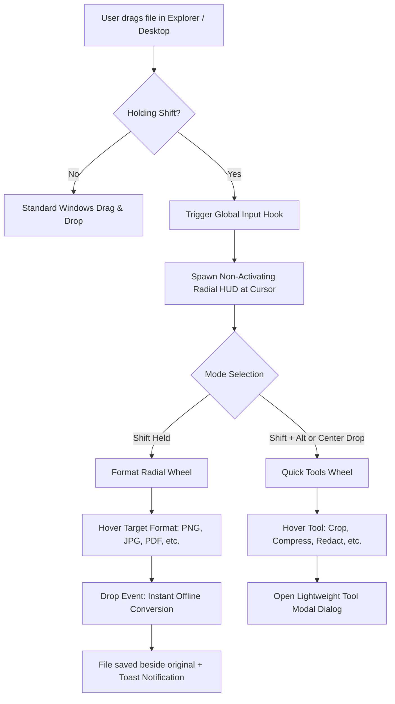
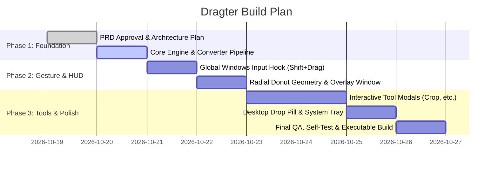

# Product Requirement Document (PRD)
## Project: Dragter — Gesture-Driven Instant File Utility for Windows

---

## 1. Executive Summary & Vision

### 1.1 Product Vision
**Dragter** is a lightweight, zero-friction Windows desktop utility that transforms mundane file operations into instant cursor-level gestures. By holding **`Shift` while dragging any file** from Windows Explorer or the Desktop, a context-aware **radial donut HUD** appears around the mouse cursor. Releasing the file over a slice executes instant offline conversions or opens specialized quick tools (Crop, Compress, Redact, Metadata, Edit, Add BG, Annotate).

### 1.2 Core Problem Statement
- Converting files (e.g., PDF to Word, PNG to WebP, PDF to JPG) traditionally requires visiting ad-heavy conversion websites, uploading sensitive data to the cloud, or launching slow, bloated software.
- Quick image operations (cropping to standard aspect ratios, blurring private information, stripping EXIF metadata) disrupt focus when done in full photo editors.

### 1.3 Key Value Propositions
- **Speed & Muscle Memory**: 1-second workflow (`Drag + Shift` $\rightarrow$ Drop on format).
- **100% Offline & Private**: Zero data leaves the local machine.
- **Warm, Premium Aesthetics**: Frosted acrylic glassmorphism, dynamic amber glow, and tactile radial geometry matching macOS Tangerine.

---

## 2. User Personas & Core Workflows

| Persona | Pain Point | How Dragter Solves It |
| :--- | :--- | :--- |
| **Web Designer / Developer** | Needs quick WebP / PNG / AVIF conversions and exact aspect ratio crops for assets. | Shift-drags assets into `WEBP` or `CROP` (16:9, 1:1, etc.) right from file folders. |
| **Business / Office Worker** | Receives PDFs needing text extraction or image exports, or needs to compress documents. | Shift-drags PDF onto `DOCX`, `TXT`, or `COMPRESS` without uploading confidential files. |
| **Privacy-Conscious User** | Sharing receipts or photos online with sensitive personal info or GPS data. | Shift-drags into `REDACT` (blackout/blur) or `METADATA` (1-click EXIF stripping). |

---

## 3. System Architecture & Interaction Design

### 3.1 Interaction Model (The "Donut" HUD)
1. **Trigger Condition**:
   - `Mouse Left Button Down` + `Shift Key Down` + mouse displacement $> 6\text{px}$.
   - Works whether `Shift` is pressed before dragging or during mouse movement.
2. **Window Lifecycle & Focus Isolation**:
   - The HUD must appear with `SW_SHOWNOACTIVATE` and `Qt.WindowType.WindowDoesNotAcceptFocus` to prevent aborting Windows Explorer's native `DoDragDrop` modal loop.
   - If the user drops outside or releases the mouse button without targeting a slice, the HUD cleanly fades out within 250ms.
3. **Dual-Wheel Architecture**:
   - **Wheel A (Formats)**: Shows compatible target extensions filtered by file category. Center hub shows source extension (e.g., `PDF`) and a toggle prompt (`⟳ Tools`).
   - **Wheel B (Tools)**: Shows 7 specialized tools (`CROP`, `COMPRESS`, `METADATA`, `EDIT`, `ANNOTATE`, `ADD BG`, `REDACT`). Center hub shows formatted file size (e.g., `1.2 MB`).

---

## 4. Functional Specifications

### 4.1 Format Wheel & Conversion Engine

| Source Category | Supported Target Formats | Engine Used | Output Behavior |
| :--- | :--- | :--- | :--- |
| **Raster Images** (`.png`, `.jpg`, `.webp`, `.bmp`, `.tiff`, `.ico`, `.avif`) | `PNG`, `JPG`, `WEBP`, `AVIF`, `BMP`, `TIFF`, `ICO`, `PDF` | Pillow (PIL) | Transparency flattened to white for JPG/BMP; non-destructive, saves as `[Name].[ext]`. |
| **PDF Documents** (`.pdf`) | `JPG`, `PNG`, `WEBP`, `DOCX`, `TXT`, `TIFF` | PyMuPDF (`pymupdf`), `python-docx` | Renders at 150 DPI. Single page $\rightarrow$ `[Name].[ext]`; Multi-page $\rightarrow$ `[Name]_Page_001.[ext]`. |
| **Documents** (`.docx`, `.doc`) | `PDF`, `TXT`, `JPG`, `PNG` | `python-docx`, PyMuPDF | Extracts structured text paragraphs and tables. |
| **Plain Text** (`.txt`, `.md`) | `PDF`, `DOCX` | PyMuPDF, `python-docx` | Formats into paginated A4 PDF or styled Word document. |

### 4.2 Quick Action Tools

#### 1. ✂ CROP Tool (Matching Image 5)
- **Preview Canvas**: Dimmed outer overlay (`rgba(0,0,0,0.6)`), rule-of-thirds grid, 8 draggable handles (corners and edges).
- **Aspect Ratio Pills**: `Free`, `1:1`, `16:9`, `9:16`, `4:3`, `3:4`.
- **Dimension Controls**: Live `W [width]` and `H [height]` inputs reflecting cropped pixel dimensions.
- **Actions**: `Reset` (restores default crop) and `Apply` (exports full-resolution crop as `[Stem] Cropped.[ext]`).

#### 2. ⤓ COMPRESS Tool
- Live quality slider ($20\%$ to $95\%$).
- Real-time estimated size reduction readout (e.g., `Original: 1.2 MB` $\rightarrow$ `Estimated: 340 KB (-71%)`).
- Lossless/lossy optimization for PNG/JPG/WebP and garbage collection/stream deflating for PDFs.

#### 3. 🏷 METADATA Tool
- Visual table displaying EXIF metadata (Device Make, Camera Model, Lens, GPS Coordinates, Timestamp, Color Profile).
- **1-Click Sanitizer**: Strips all identifying tags for privacy and exports `[Stem] Cleaned.[ext]`.

#### 4. 👁 REDACT Tool
- Interactive canvas to draw bounding boxes over sensitive information.
- Modes: **Blackout** (solid black censorship bar) or **Blur** (Gaussian pixel blur).

#### 5. ⚙ EDIT Tool
- Real-time adjustment sliders: Brightness, Contrast, Saturation.
- Quick transform actions: Rotate 90° CW, Flip Horizontal, Flip Vertical, Grayscale (B&W), Invert.

#### 6. 🖼 ADD BG Tool
- Designed for transparent PNGs/SVGs or product shots.
- Solid background colors (`White`, `Dark`, `Amber`, `Slate`, `Sky`, `Custom Color Dialog`).
- Padding/margin slider (0px to 150px).

#### 7. ✏ ANNOTATE Tool
- Markup canvas supporting: Freehand Pen, Highlighter, Arrow tool, and Bounding Box tool.

---

## 5. UI/UX & Liquid Animation System

### 5.1 Organic Liquid Physics Model
Dragter uses a **60 FPS continuous spring-mass-damper simulation** to make the radial HUD behave like viscous, fluid amber droplets:

1. **Fluid Blooming Entrance**:
   - The HUD blooms outward from the cursor with an elastic swirl rather than an abrupt pop.
   - Per-petal staggered blossom expansion ($t_i = i \times 15\text{ms}$).
2. **Surface Tension & Dynamic Bulge**:
   - Hovered petals swell radially outward by **$+18\text{px}$** and expand angularly.
   - **Neighbor Coupling**: Adjacent petals dynamically stretch by **$+6.5\text{px}$**, simulating surface tension pulling neighboring fluid.
   - Continuous subtle surface tension micro-wave: $\text{wobble} = \sin(t \times 3.8 + \phi) \times 1.2$.
3. **Magnetic Ferrofluid Center Hub**:
   - The center hub is elastically pulled toward the active petal by **$9\text{px}$** like magnetic liquid.
   - On release, the hub spring-bounces back to center with viscous fluid damping.
4. **Liquid Splash Particles & Shockwave**:
   - On file drop, a high-velocity particle emitter bursts 18 liquid amber droplet particles with gravity and viscous air resistance.
   - An expanding shockwave ripple ring radiates outward through the outer petals.
   - Center hub performs a fluid jelly rebound squash & stretch ($0.72 \rightarrow 1.28 \rightarrow 1.0$).
5. **Specular Caustics & Sheen Shading**:
   - Curved glossy reflection arcs along the outer rim (`rgba(255, 255, 255, 0.5)`).
   - Multi-stop fluid amber gradients with translucent caustics.

---

## 6. Technical Stack & Dependencies

| Component | Library / Framework | Justification |
| :--- | :--- | :--- |
| **GUI Framework** | `PyQt6` | Hardware-accelerated 2D rendering (`QPainter`), frameless translucent windowing, robust drag-and-drop OLE event system. |
| **Low-Level Hook** | `pynput` + Windows `GetAsyncKeyState` | Direct hardware state polling without stealing Explorer drag capture or triggering UAC delays. |
| **Image Processing** | `Pillow` (PIL) | Industry-standard raster image conversions, format negotiation, and EXIF manipulation. |
| **PDF Engine** | `PyMuPDF` (`pymupdf`) | Ultra-fast C-based rendering, multi-page vector rasterization, PDF deflating and text extraction. |
| **Document Processing**| `python-docx` | Native XML-based Word document synthesis and parsing. |

---

## 7. Performance & Quality Targets

- **HUD Trigger Latency**: $< 25\text{ms}$ between gesture recognition and window display.
- **Conversion Latency**: $< 350\text{ms}$ for standard image conversions; $< 1.5\text{s}$ for 10-page PDFs.
- **Idle Memory Footprint**: $< 85\text{MB}$ RAM when idling in the system tray.
- **Collision Handling**: Never overwrites existing files — auto-increments with `(1)`, `(2)`, etc.

---

## 8. Implementation Phases

